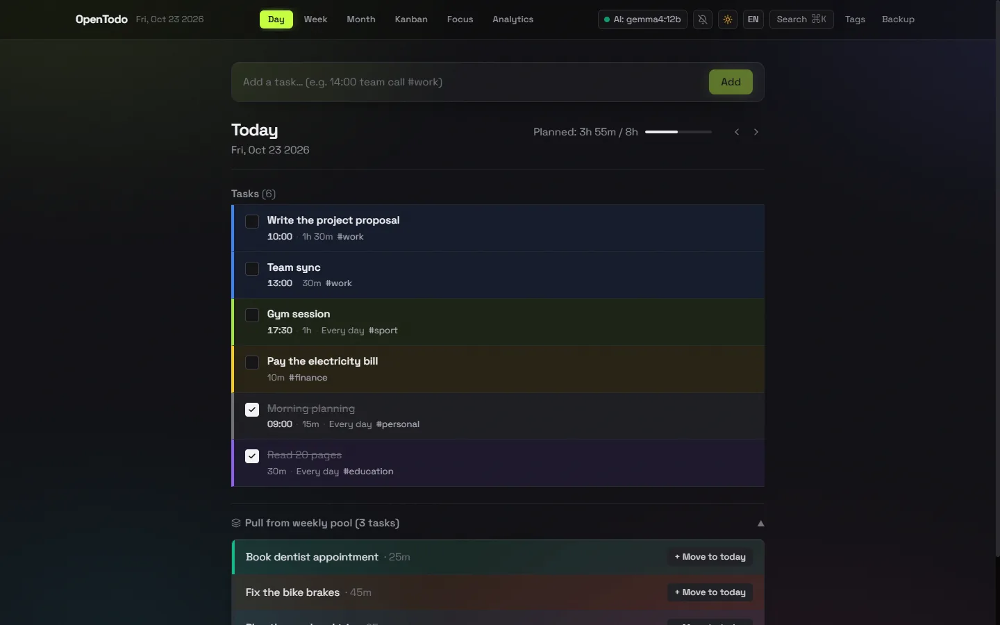

# OpenTodo

A free, open-source Day / Week / Month planner. English by default, Turkish one click away.

**Website:** https://eryukselaskar.github.io/opentodo/ ·
**Use in the browser:** https://eryukselaskar.github.io/opentodo/app/ ·
**Download for Windows:** [OpenTodo-Setup.exe](https://github.com/eryukselaskar/opentodo/releases/latest/download/OpenTodo-Setup.exe)



## Features

- Day, Week and Month views with weekly and monthly task pools
- Recurring routines (daily, weekly, monthly, chosen weekdays) with a 30-day history and streaks
- Kanban board, Pomodoro focus timer and analytics
- Quick add with tokens: `#tag`, `!urgent`, `~45m`, `@tomorrow`, `%daily`, `14:00`
- Colored tags, reminders for timed tasks, JSON backup and automatic file backup
- Desktop app for Windows: runs in the tray, can start with Windows
- **Bring your own AI** (optional): local [Ollama](https://ollama.com) with any model, or any OpenAI-compatible API (OpenAI, OpenRouter, Groq, LM Studio …). Click the "AI" badge in the header to set it up.

All data stays on your device (localStorage). There is no account and no server.

> Using Ollama from the website? Start Ollama with `OLLAMA_ORIGINS=*` so the page is allowed to reach it. The desktop app needs no extra setup.

## Development

```bash
npm install
npm run dev            # dev server
npm test               # tests
npm run lint
npm run build          # production build
npm run desktop        # run the Electron desktop app
npm run desktop:dist   # build the Windows installer (release/OpenTodo-Setup.exe)
```

The product page lives in `site/`; GitHub Actions publishes it at the site root and the app under `/app/`.

Built with Vite, React 19, TypeScript, Tailwind CSS and Zustand.

## License

[MIT](LICENSE)
